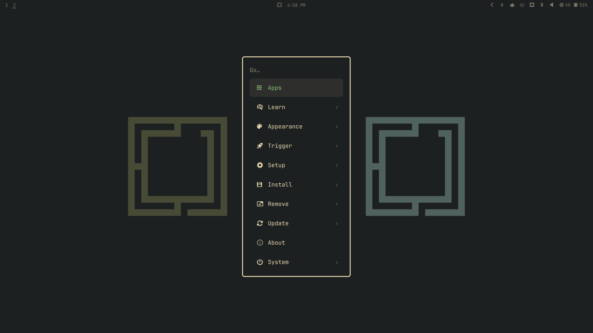
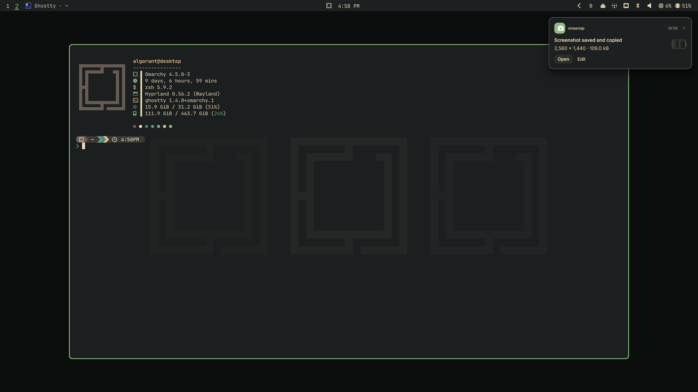
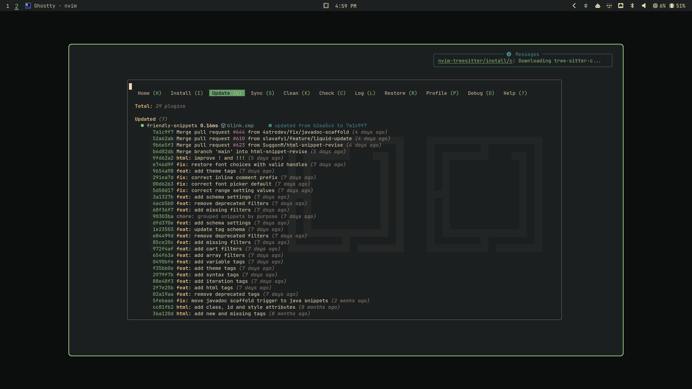
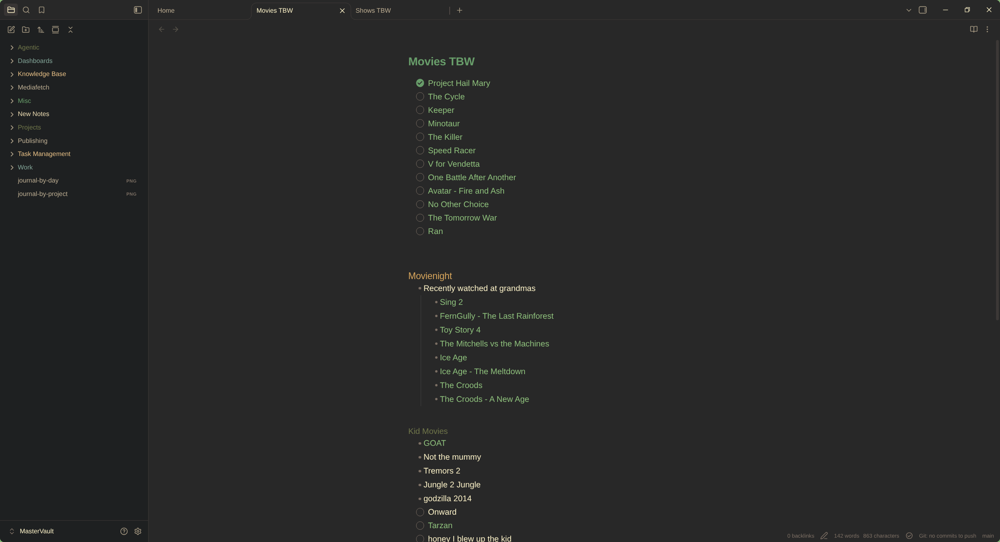
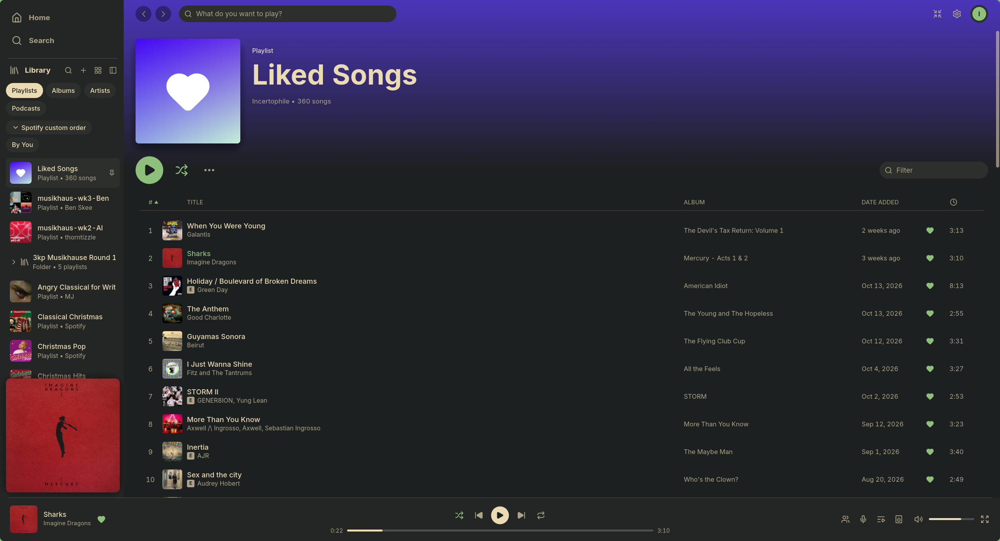
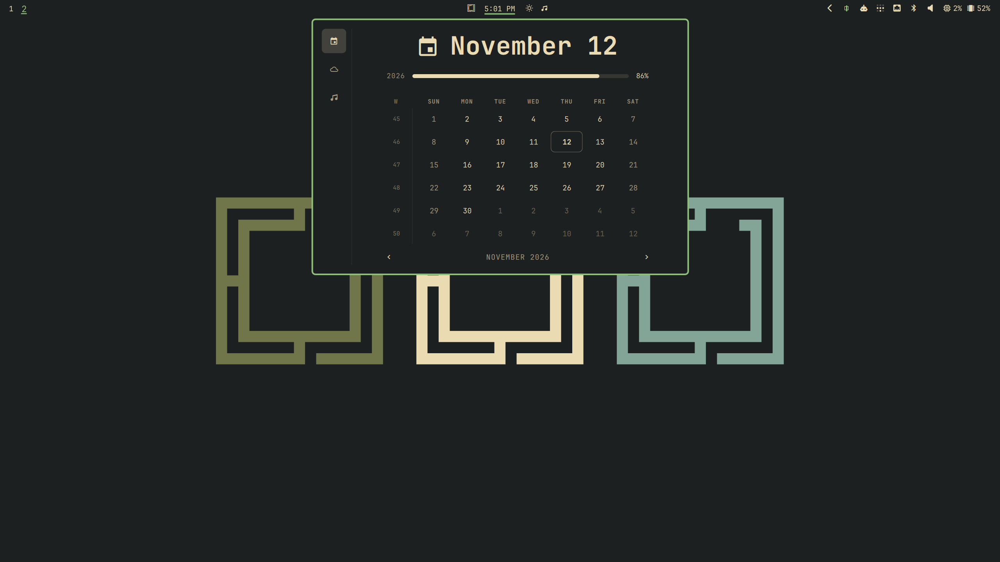

verdigris is a dark mode colorscheme built around oxidized copper: weathered bronze, warm vellum, patina green, cool aqua, brass ochre. 

It is what I use on every machine, ported to the software I actually run.

Six core colours carry the scheme: ashbronze metal, vellum text, fern and patina greens, aqua, ochre. Everything else in the palette is a supporting role for one app or one state, listed in [`palette/verdigris.json`](palette/verdigris.json).

## what it looks like

The shell, menus and wallpapers on my desktop.

A floating terminal, running the omarchy fastfetch.

Neovim, with lazy open.

My vault in Obsidian.

Spotifast, my spotify client.

The calendar widget, one of the quickshell panels.

## apps

omarchy · [herdr app](apps/herdr-app) · [ghostty](apps/ghostty) · [foot](apps/foot) · [chromium](apps/chromium) · [obsidian](apps/obsidian) · [spotifast](apps/spotifast) · [quickshell](apps/quickshell) · [hokum](apps/hokum) · [hyprland](apps/hyprland) · [neovim](apps/neovim) · [pi](apps/pi) · [claude code](apps/claude-code) · [btop](apps/btop) · [atuin](apps/atuin) · [yazi](apps/yazi) · [leaf](apps/leaf) · [tandem](apps/tandem) · [starship](apps/starship) · [zsh-patina](apps/zsh-patina) · [eza](apps/eza) · [fastfetch](apps/fastfetch)

## how to use

Don't clone this into your config. Copy the file for the app you want from its folder, or point your agent at the palette and have it build the rest.

Some files are generated from the palette in [`build/generate.py`](build/generate.py); the rest are hand-written and checked against it.

## License

[MIT](LICENSE)
