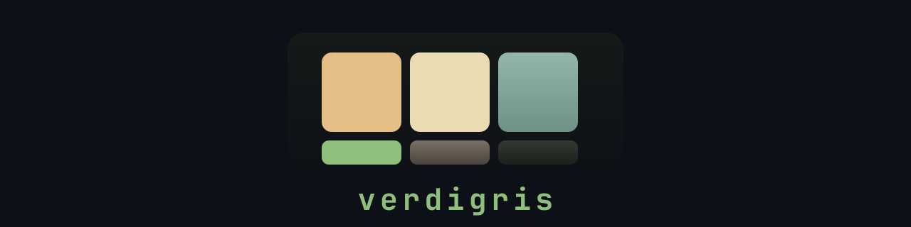

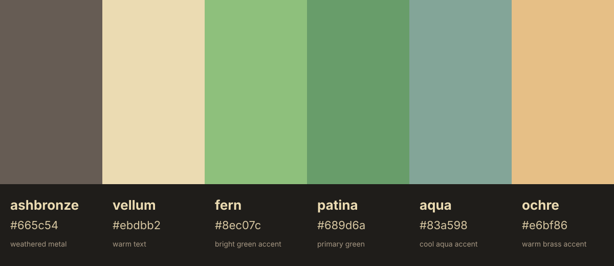

- a dark mode colorscheme built around oxidized copper: somewhere between gruvbox dark and everforest.
- Six core colors carry the scheme, plus some [additional colors](palette/notes.md#additional-colors).

## gallery

<table>
  <tr>
    <td align="center"><a href="apps/omarchy/screenshot.png">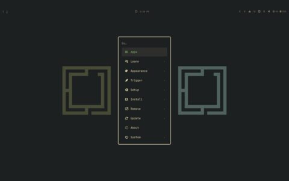</a> omarchy</td>
    <td align="center"><a href="apps/omarchy/screenshot-2.png">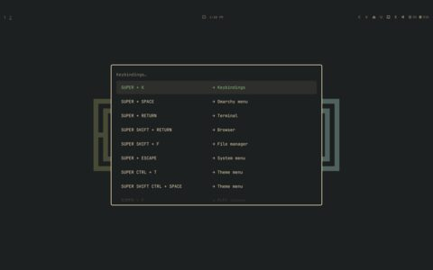</a> omarchy · keybindings</td>
    <td align="center"><a href="apps/ghostty/screenshot.png">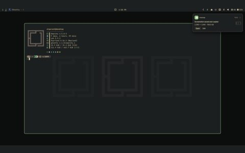</a> ghostty · fastfetch</td>
  </tr>
  <tr>
    <td align="center"><a href="apps/nvim/screenshot-3.png">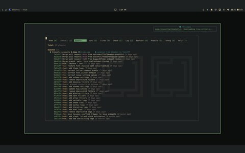</a> neovim · lazy</td>
    <td align="center"><a href="apps/obsidian/screenshot.png">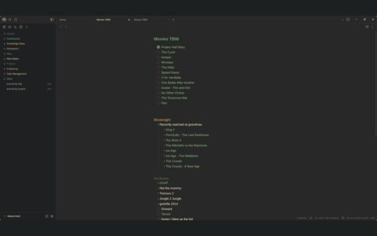</a> obsidian</td>
    <td align="center"><a href="apps/spotifast/screenshot.png">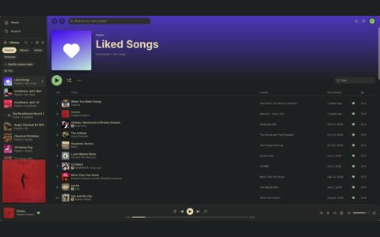</a> spotifast</td>
  </tr>
  <tr>
    <td align="center"><a href="apps/leaf/screenshot.png">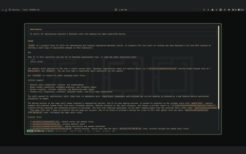</a> leaf</td>
    <td align="center"><a href="apps/btop/screenshot.png">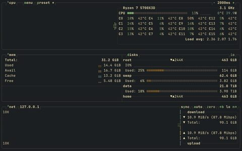</a> btop</td>
    <td align="center"><a href="apps/omarchy/widgets/calendar.png">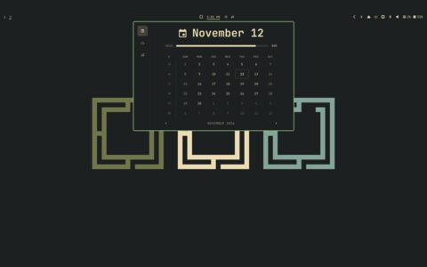</a> calendar widget</td>
  </tr>
</table>

more screenshots

<table>
  <tr>
    <td align="center"><a href="apps/yazi/screenshot.png">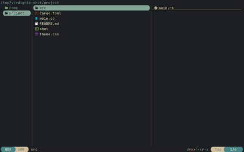</a> yazi</td>
    <td align="center"><a href="apps/nvim/screenshot.png">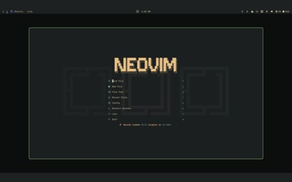</a> neovim</td>
    <td align="center"><a href="apps/omarchy/widgets/system-monitor.png">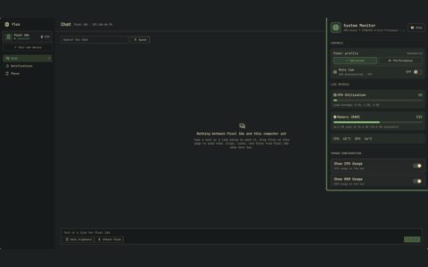</a> system monitor</td>
  </tr>
  <tr>
    <td align="center"><a href="apps/atuin/screenshot.png">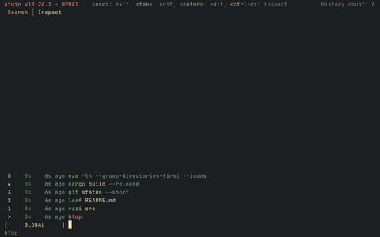</a> atuin</td>
    <td align="center"><a href="apps/tandem/screenshot-2.png">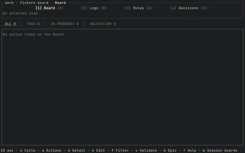</a> tandem</td>
    <td align="center"><a href="apps/starship/screenshot.png">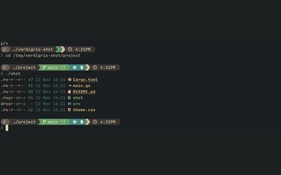</a> starship</td>
  </tr>
</table>

## os

[omarchy](apps/omarchy) · [widgets](apps/omarchy/widgets) · [hyprland](apps/omarchy/hyprland) · [floating terminal](apps/omarchy/floating-terminal) · [omari](apps/omarchy/omari) · [hokum](apps/hokum)

## terminal/cli

[ghostty](apps/ghostty) · [nvim](apps/nvim) · [lazygit](apps/lazygit) · [pi](apps/pi) · [atuin](apps/atuin) · [eza](apps/eza) · [btop](apps/btop) · [yazi](apps/yazi) · [leaf](apps/leaf) · [starship](apps/starship) · [fastfetch](apps/fastfetch) · [zsh](apps/zsh)

## apps

[flea](apps/flea) · [herdr](apps/herdr) · [obsidian](apps/obsidian) · [spotifast](apps/spotifast) · [tandem](apps/tandem)

## how to use

Don't try to install anything. Point your agent at whatever you like that looks nice, and have it make you a version of it.

## License

[MIT](LICENSE)
