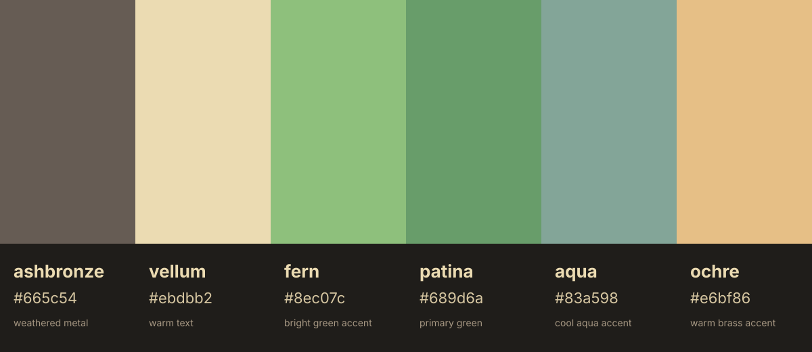

# Verdigris



Verdigris is a small theme family inspired by oxidized copper: weathered bronze, warm vellum, patina greens, cool aqua, brass ochre.

Not quite gruvbox-dark, and not quite everforest, but inspired by both.

## Core palette


| Name | Hex | Role |
|---|---:|---|
| ashbronze | `#665c54` | background / weathered metal |
| vellum | `#ebdbb2` | foreground / warm text |
| fern | `#8ec07c` | bright green accent |
| patina | `#689d6a` | primary green |
| aqua | `#83a598` | cool aqua accent |
| ochre | `#e6bf86` | warm brass accent |

Machine-readable palette available [`here`](./css/palette.json).

## Versioning

The palette follows [Semantic Versioning](https://semver.org/) beginning with `0.1.0`. The current version is recorded in [`css/palette.json`](./css/palette.json), and release history is tracked in [`CHANGELOG.md`](./CHANGELOG.md). Application ports may adopt palette releases independently.

## Additional Colors

The core palette stays deliberately small.

Need red for a diff? Want yellow for a warning or search highlight?
An extended set of additional colors is available for ports that need specific roles outside the core palette.
See [Additional Colors](./additional-colors/).

## Ports

| Port | Description | Notes |
| --- | --- | --- |
| [Neovim](./nvim/) | Editor colorscheme | [Standalone public repository](https://github.com/Algorant/verdigris.nvim) |
| [Obsidian](./obsidian/) | Minimal/Gruvbox-grounded theme experiment | Includes consolidation notes |
| [Starship](./starship/) | Segmented terminal prompt palette | |
| [Ghostty](./ghostty/) | Terminal ANSI palette | |
| [Windows Terminal](./windows-terminal/) | Terminal color scheme | Includes Arch Linux profile icons |
| [lsd](./lsd/) | File-listing metadata palette | |
| [Atuin](./atuin/) | Shell-history TUI theme | |
| [btop](./btop/) | Resource-monitor graph theme | |
| [bat](./bat/) | Syntax-highlighting theme | Run `bat cache --build` after install or theme edits |
| [Yazi](./yazi/) | Terminal file-manager theme | |
| [ncspot](./ncspot/) | Terminal Spotify-client theme | |
| [Pi](./pi/) | Coding-agent UI theme | |
| [Omarchy](https://github.com/Algorant/omarchy-verdigris-theme) | Desktop theme with triptych wallpapers and recoloured alternates | Install: `omarchy theme install https://github.com/Algorant/omarchy-verdigris-theme` |
| [Claude Code](./claude-code/) | Coding-agent TUI theme | |
| [Herdr](./herdr/) | Gruvbox-based terminal workspace overrides | |

## Contributor checks

Install the push scanner and enable this repository's pre-push hook on each clone:

```sh
mise install gitleaks@8.30.1
git config core.hooksPath .githooks
```

The hook also requires a locally provisioned `$HOME/.config/privacy-check/literals.gitleaks.toml` (permissions `0600`) for personal privacy rules, and fails if it is missing. Keep this file outside every repository; never commit it.

The hook scans outgoing commits and their metadata with Gitleaks' default secret rules, generic project privacy rules and the local policy. It covers ordinary pushes of every branch, including manual board pushes. Tandem's automatic sync currently bypasses Git hooks; its scanning policy is still being decided.

## Palette artifacts

- [`css/palette.json`](./css/palette.json) — canonical machine-readable palette data
- [`css/palette.css`](./css/palette.css) — CSS custom properties for ports and color preview tools
- [`css/palette-notes.md`](./css/palette-notes.md) — design notes, role decisions, and palette history
- [`_images/verdigris-core-swatch.svg`](./_images/verdigris-core-swatch.svg) — core swatch
- [`additional-colors/`](./additional-colors/) — additional colors guide and swatch
