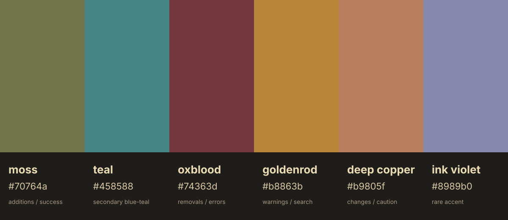

# Additional Colors

Palette version: `0.1.2`

The core Verdigris palette is intentionally small. These additional colors are the extended set for ports that need specific roles outside the core identity palette: diffs, warnings, search highlights, diagnostics, ANSI slots, or syntax accents.

| Name | Hex | Role |
|---|---:|---|
| moss | `#70764a` | additions / success |
| teal | `#458588` | secondary blue-teal |
| oxblood | `#74363d` | removals / errors |
| goldenrod | `#b8863b` | warnings / search |
| deep-copper | `#b9805f` | changes / caution |
| ink-violet | `#8989b0` | rare / special accent |

## Examples

##todo add examples from nvim, obsidian, diffs showing the additional colors.

