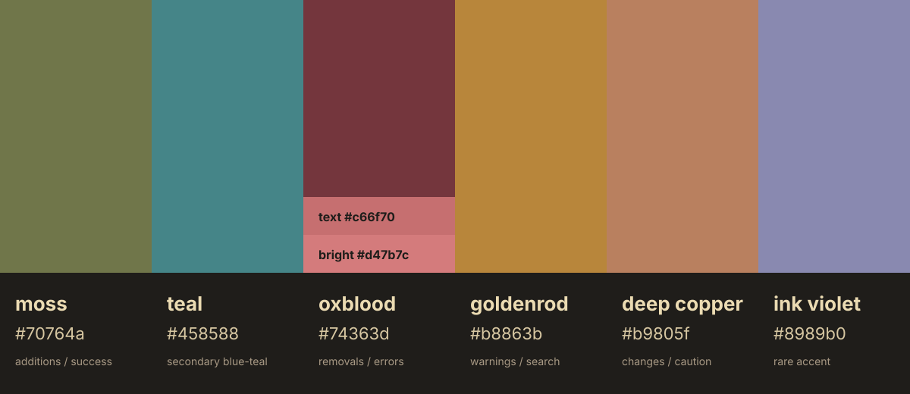

# Additional Colors

Palette version: `0.2.0`

| Name | Hex | Role |
|---|---:|---|
| moss | `#70764a` | additions / success |
| teal | `#458588` | secondary blue-teal |
| oxblood | `#74363d` | removals / errors |
| goldenrod | `#b8863b` | warnings / search |
| deep-copper | `#b9805f` | changes / caution |
| ink-violet | `#8989b0` | rare / special accent |
