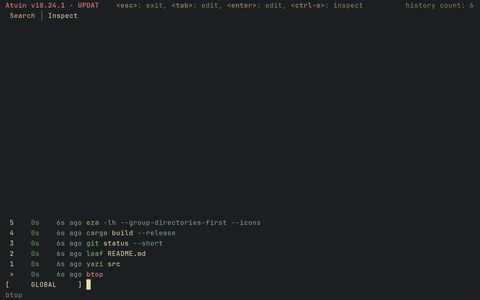

# atuin

<table>
  <tr>
    <td align="center"> my history</td>
    <td align="center"> a fixture render</td>
  </tr>
</table>

- Shell history, searched from the terminal
- [atuin](https://github.com/atuinsh/atuin)

## files

- `verdigris.toml`
