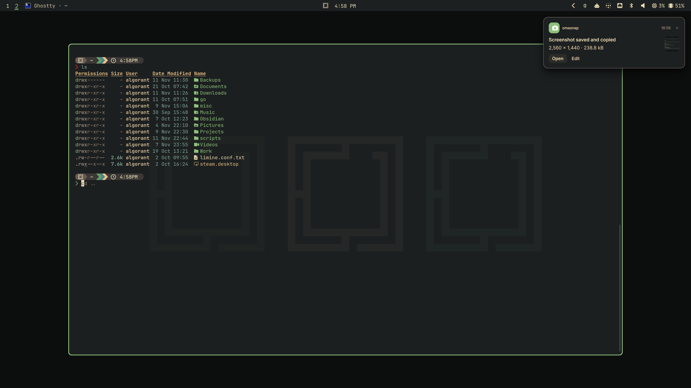
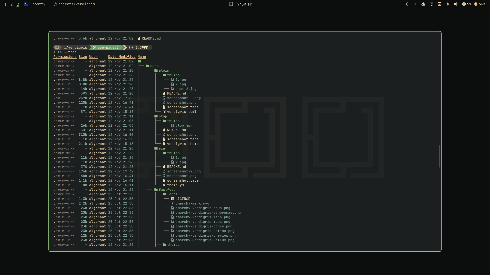

# verdigris for eza

<table>
  <tr>
    <td align="center"> my ls alias</td>
    <td align="center"> tree view</td>
  </tr>
</table>

File listing, colored. [eza](https://github.com/eza-community/eza)

## files

- `theme.yml`
