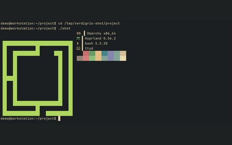

# fastfetch

<table>
  <tr>
    <td align="center"> shot</td>
  </tr>
</table>

- System summary, printed at login
- [fastfetch](https://github.com/fastfetch-cli/fastfetch)

## files

- `config.jsonc`
- `logos/`
