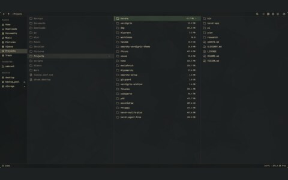
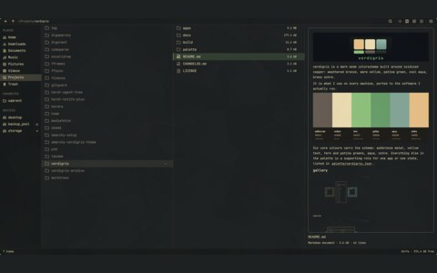
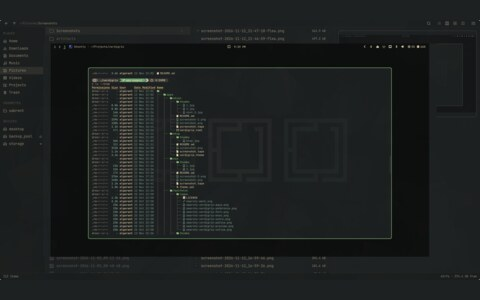
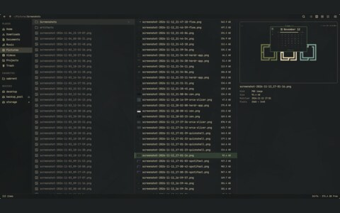

# flea

<table>
  <tr>
    <td align="center"> three columns</td>
    <td align="center"> a readme in the preview</td>
    <td align="center"> a folder of screenshots</td>
  </tr>
  <tr>
    <td align="center"> with the preview open</td>
  </tr>
</table>

- Keyboard-first file manager
- [thisisgm/flea](https://github.com/thisisgm/flea)

## files

- none here: it takes its colours from the [omarchy theme](../omarchy)

## notes

Installed from Omarchy's package repo, where it is the default file manager and the file chooser.
