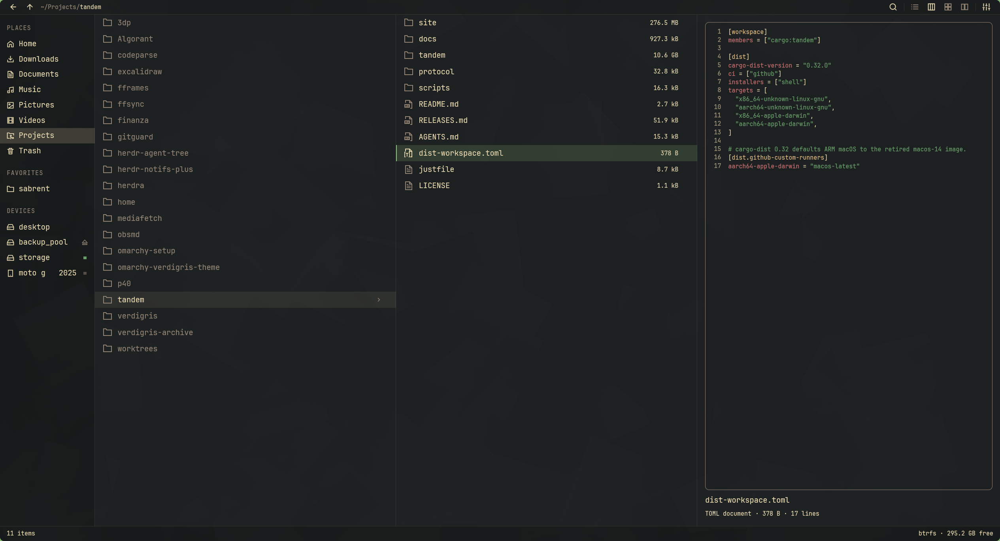
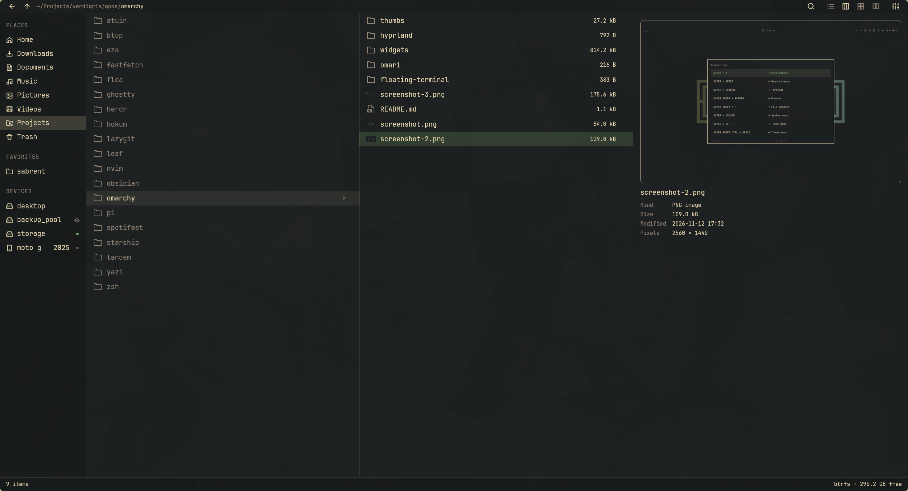

# verdigris for flea

<table>
  <tr>
    <td align="center"> flea</td>
    <td align="center"> flea, second view</td>
  </tr>
</table>

Keyboard-first file manager. [thisisgm/flea](https://github.com/thisisgm/flea)

## files

- none here: it takes its colors from the [omarchy theme](../omarchy)

## notes

Installed from Omarchy's package repo, where it is the default file manager and the file chooser.
