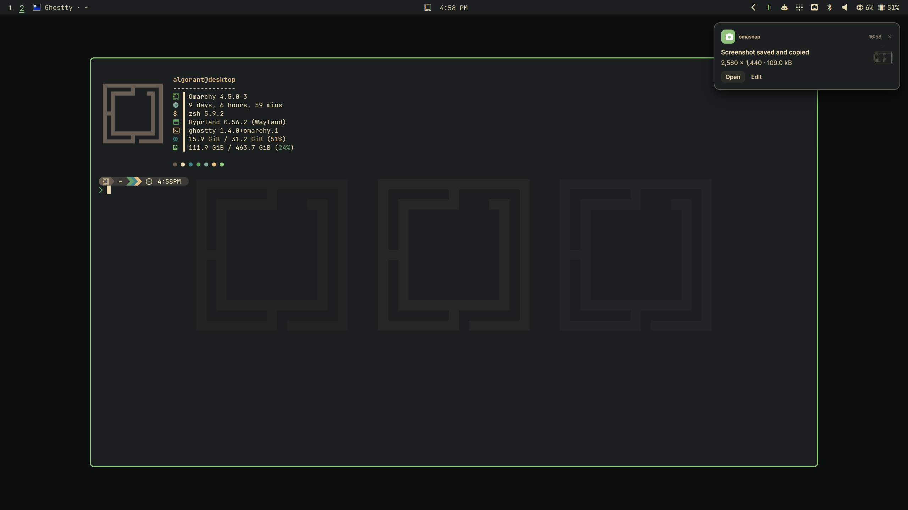
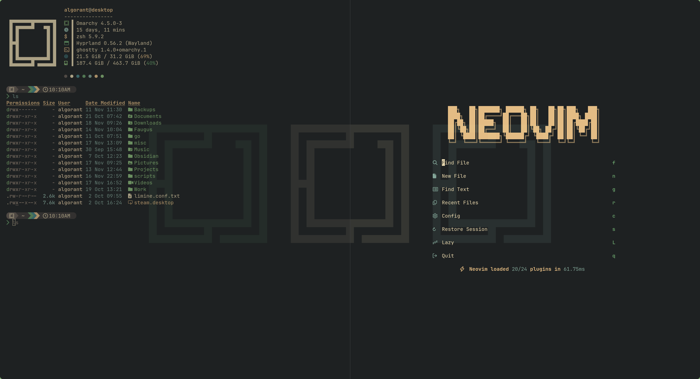

# verdigris for ghostty

<table>
  <tr>
    <td align="center"> terminal</td>
    <td align="center"> terminal, second view</td>
  </tr>
</table>

Terminal. [ghostty](https://github.com/ghostty-org/ghostty)

## files

- `verdigris`
