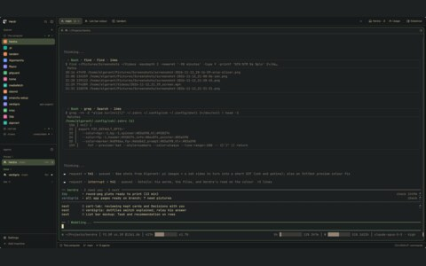
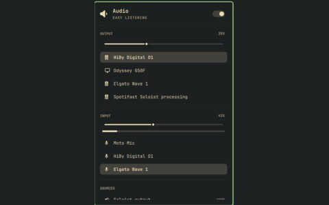

# herdr

<table>
  <tr>
    <td align="center"> herdr</td>
    <td align="center"> a panel</td>
  </tr>
</table>

- Terminal and agent window
- [herdr](https://herdr.dev)

## files

- `verdigris.json`
