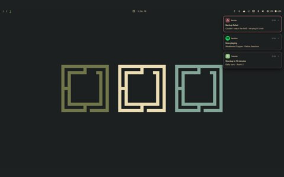
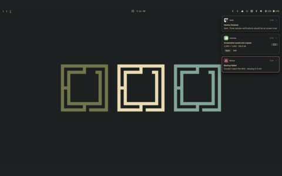

# hokum

<table>
  <tr>
    <td align="center"> three cards</td>
    <td align="center"> cards close up</td>
  </tr>
</table>

- Notification cards, in the theme's colours
- [hokum](https://github.com/Algorant/hokum)

## files

- `verdigris-capsule.kdl`
