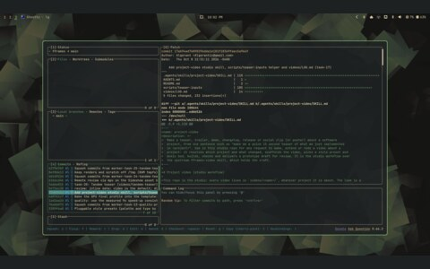

# lazygit

<table>
  <tr>
    <td align="center"> before the port: his first look</td>
  </tr>
</table>

- A terminal UI for git
- [jesseduffield/lazygit](https://github.com/jesseduffield/lazygit)

## files

- [config.yml](config.yml): the `gui.theme` block, pasted into `~/.config/lazygit/config.yml`

## notes

Fern marks the active panel, ashbronze the idle ones, and the lighter background sits under the selected line. Staged and unstaged changes use oxblood's text tint, which is the only red in the palette that stays readable on `#1d2021`.
