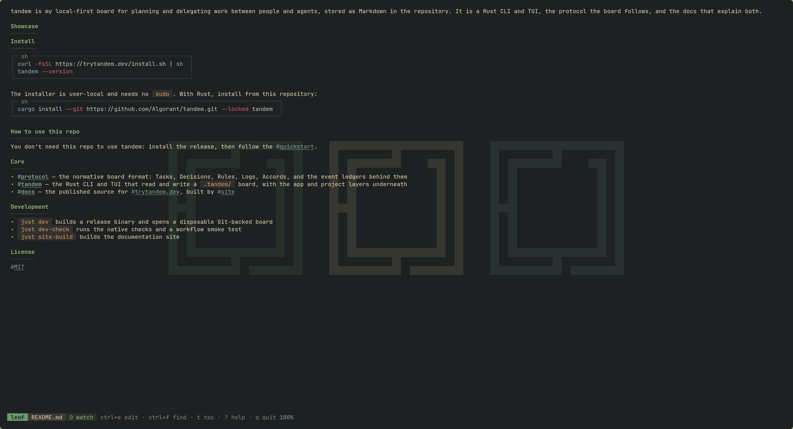
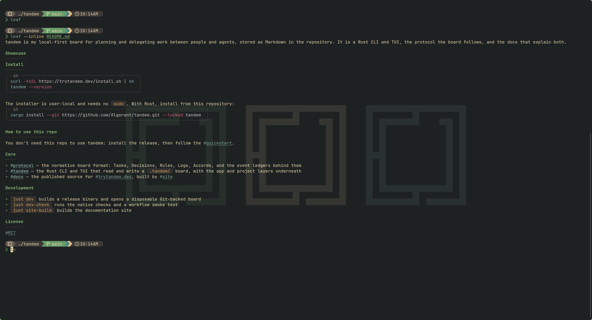

# verdigris for leaf

<table>
  <tr>
    <td align="center"> notes with the contents open</td>
    <td align="center"> leaf, second view</td>
  </tr>
</table>

Markdown reader for the terminal. [leaf](https://github.com/rivolink/leaf)

## files

- `verdigris.toml`
