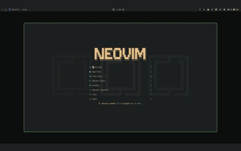
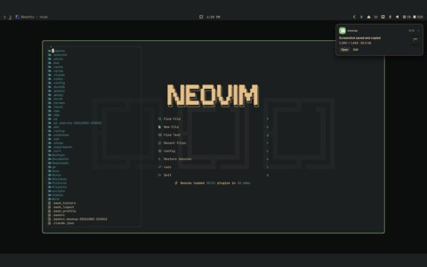
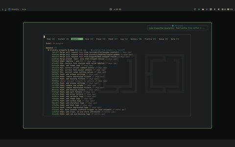
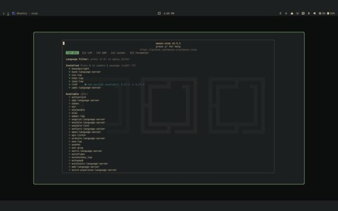

# verdigris-nvim

## files

- the colourscheme lives in its own repository: [Algorant/verdigris.nvim](https://github.com/Algorant/verdigris.nvim)

## gallery

<table>
  <tr>
    <td align="center"> neovim</td>
    <td align="center"> file picker</td>
    <td align="center"> lazy</td>
  </tr>
  <tr>
    <td align="center"> mason</td>
  </tr>
</table>

## notes

Dark only. The plugin owns the highlight groups; its own README can be brought to this shape later.
