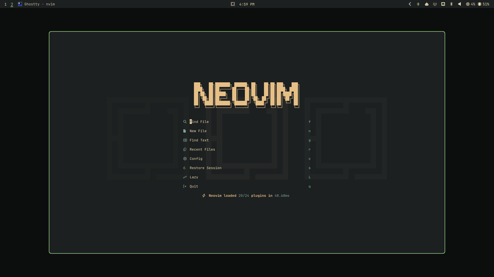
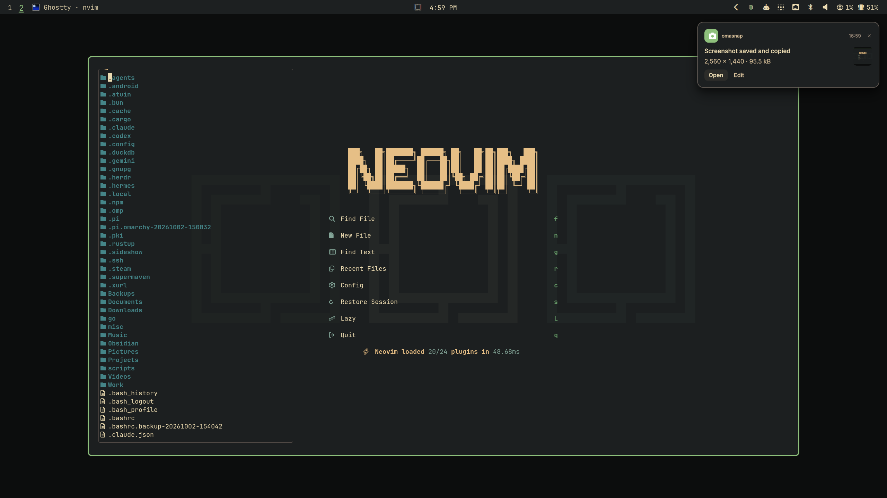
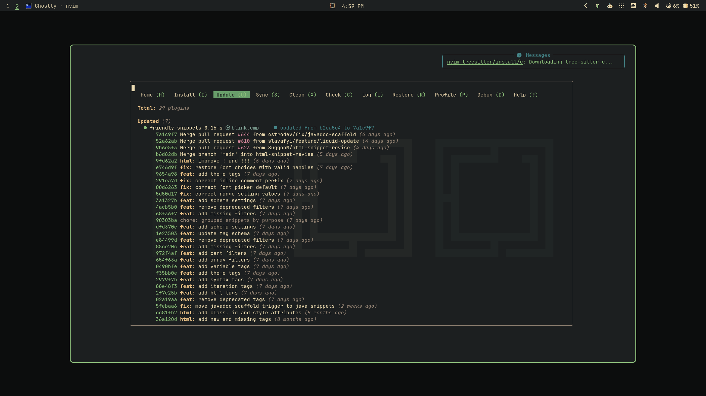
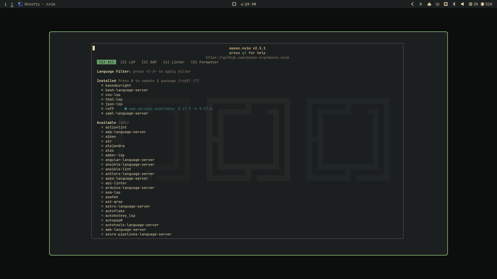

# verdigris for neovim

<table>
  <tr>
    <td align="center"> nvim</td>
    <td align="center"> file picker</td>
  </tr>
  <tr>
    <td align="center"> lazy</td>
    <td align="center"> mason</td>
  </tr>
</table>

Colorscheme for neovim. [Algorant/verdigris.nvim](https://github.com/Algorant/verdigris.nvim)

## files

- none here: the colorscheme and its plugin spec live in that repository
