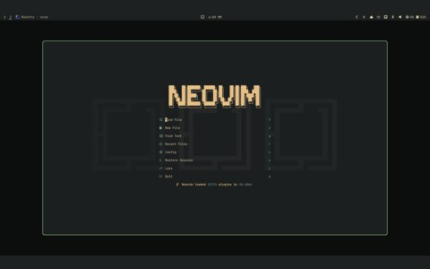
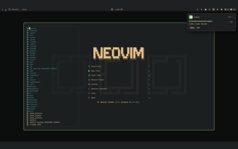
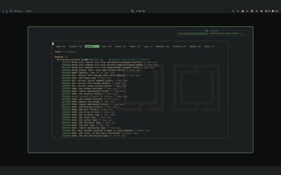
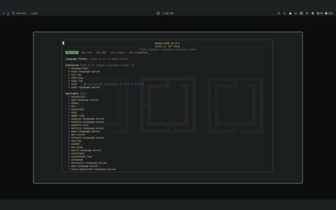

# nvim

## gallery

<table>
  <tr>
    <td align="center"> nvim</td>
    <td align="center"> file picker</td>
    <td align="center"> lazy</td>
  </tr>
  <tr>
    <td align="center"> mason</td>
  </tr>
</table>

## files

- [Algorant/verdigris.nvim](https://github.com/Algorant/verdigris.nvim) — the colourscheme, including its plugin spec

## project

- Editor, with the verdigris colourscheme
- [neovim](https://github.com/neovim/neovim) and [Algorant/verdigris.nvim](https://github.com/Algorant/verdigris.nvim)
