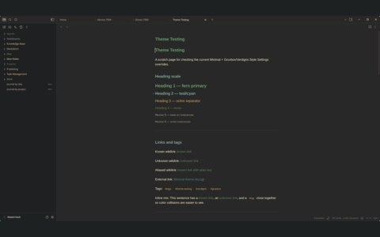
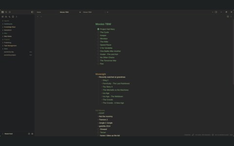

# obsidian

<table>
  <tr>
    <td align="center"> note</td>
    <td align="center"> second note</td>
  </tr>
</table>

- Notes, wearing the theme
- [obsidian](https://obsidian.md)

## files

- `verdigris.css`
