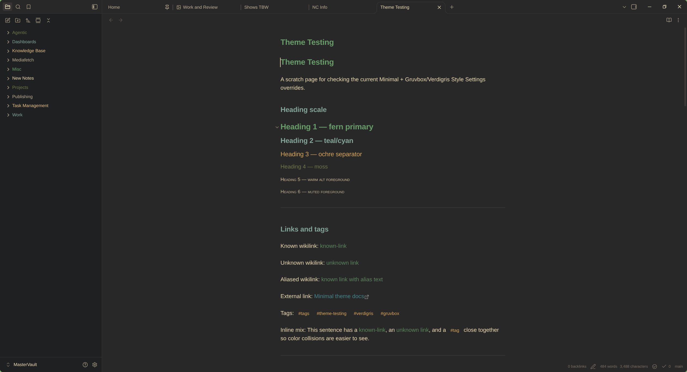

# verdigris for obsidian

<table>
  <tr>
    <td align="center"> obsidian</td>
  </tr>
</table>

Notes, wearing the theme. [obsidian](https://obsidian.md)

## files

- `verdigris.css`

## install

Copy this file into the vault's `.obsidian/snippets/`; do not link it.

## notes

A vault is a Git repository, and Git keeps a symlink as a pointer, so a backup of the vault would carry the pointer and lose the colors.
