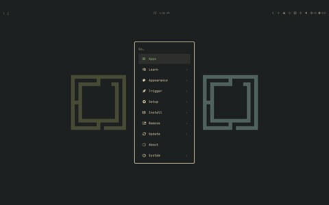
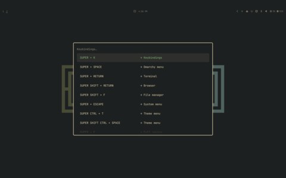

# omarchy-verdigris-theme

## files

- [`colors.toml`](https://github.com/Algorant/omarchy-verdigris-theme/blob/main/colors.toml) — the theme's colours, in the [theme repository](https://github.com/Algorant/omarchy-verdigris-theme)
- wallpapers — two triptychs and 26 recoloured alternates, in the same repository

## gallery

<table>
  <tr>
    <td align="center"> omarchy</td>
    <td align="center"> keybindings</td>
  </tr>
</table>

## notes

Dark only. Omarchy generates the per-app files for ghostty, foot, hyprland, chromium and the shell from this theme's colours; the apps worth their own page have one.

Install it with `omarchy theme install https://github.com/Algorant/omarchy-verdigris-theme`.
