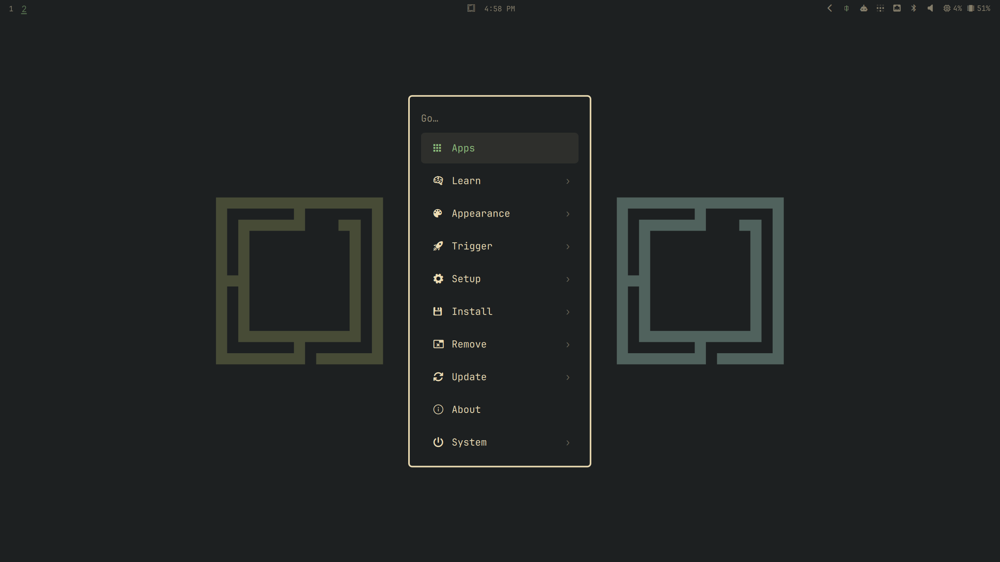
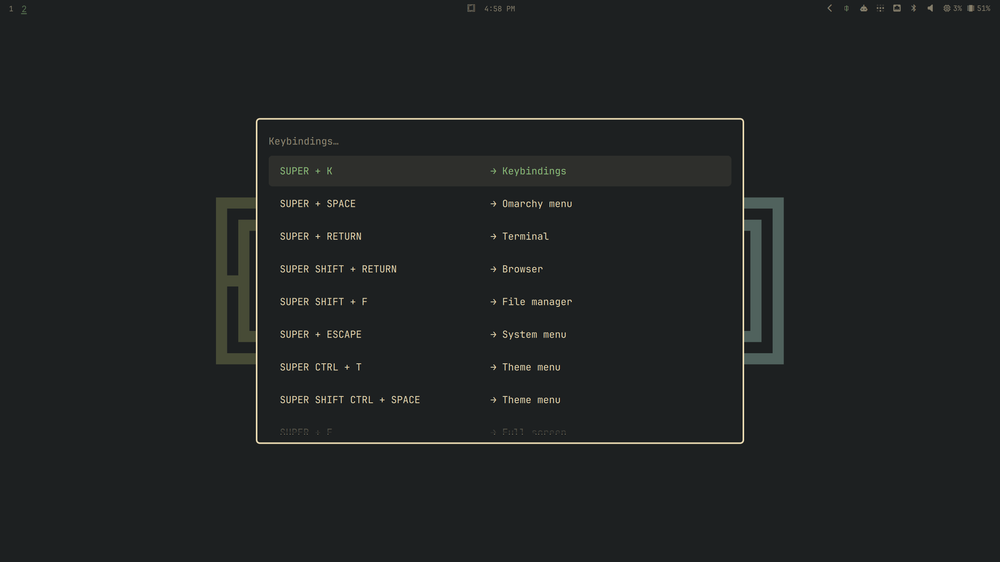
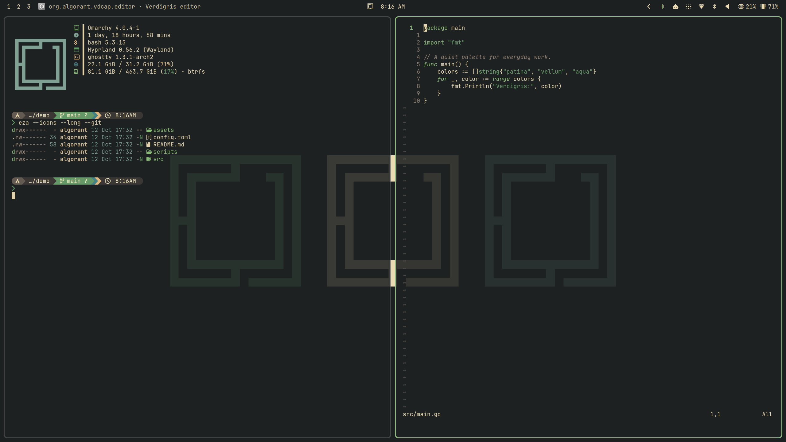

# verdigris for omarchy

<table>
  <tr>
    <td align="center"> desktop</td>
    <td align="center"> keybindings</td>
    <td align="center"> workstation</td>
  </tr>
</table>

Desktop theme for omarchy: bar, menus, borders and wallpapers.
[omarchy-verdigris-theme](https://github.com/Algorant/omarchy-verdigris-theme) · [algOS](https://github.com/Algorant/algOS)

## files

- `colors.toml` and `backgrounds/` live in the theme repository

## install

`omarchy theme install https://github.com/Algorant/omarchy-verdigris-theme` installs it as `verdigris`.

## parts

- [widgets](widgets) · [hyprland](hyprland) · [floating terminal](floating-terminal) · [omari](omari) · [hokum](../hokum)
