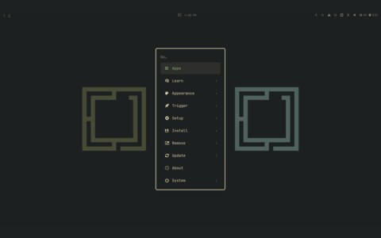

# floating terminal

<table>
  <tr>
    <td align="center"> a floating terminal over the desktop</td>
  </tr>
</table>

- ghostty in a floating window, bound in my hyprland config
- [omarchy](https://github.com/omacom/omarchy), with the colors from [ghostty](../../ghostty)
