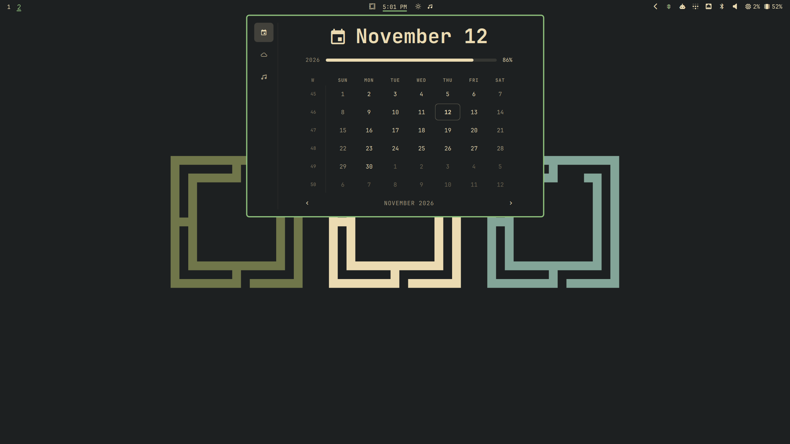
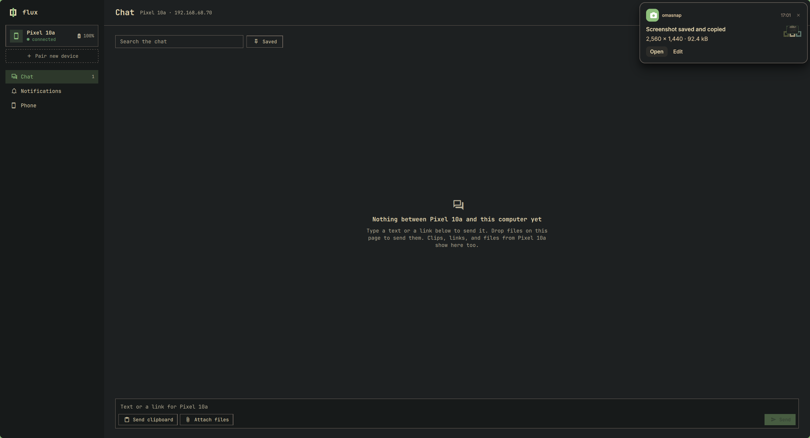
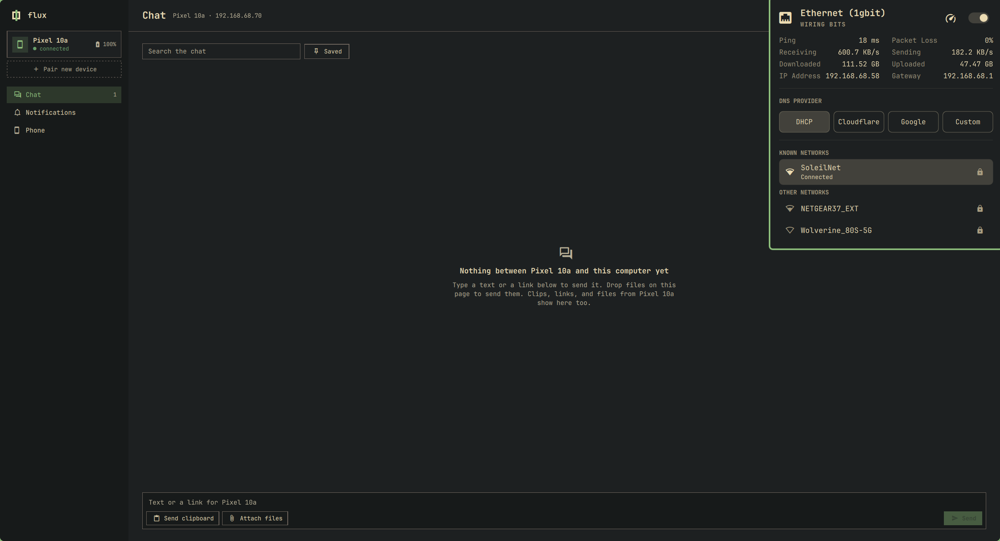
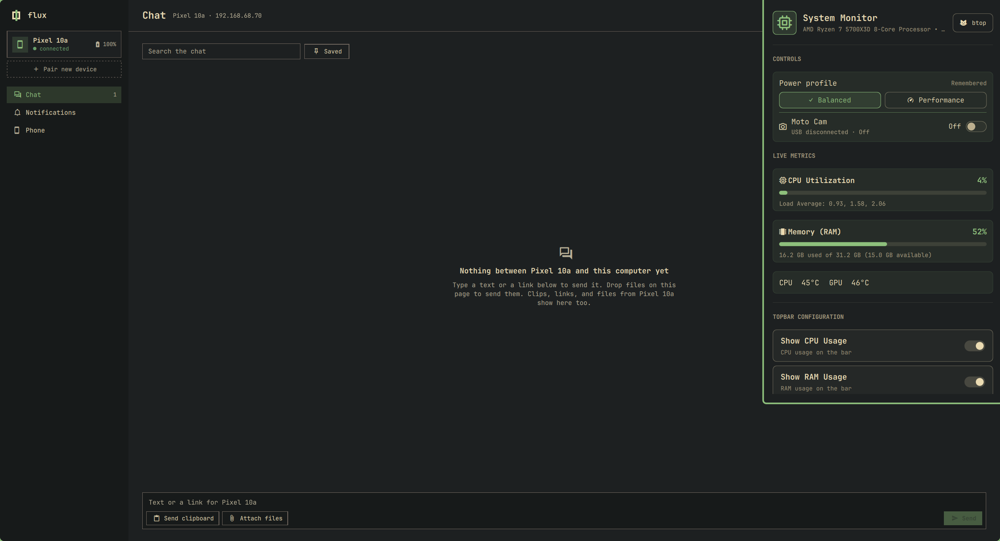
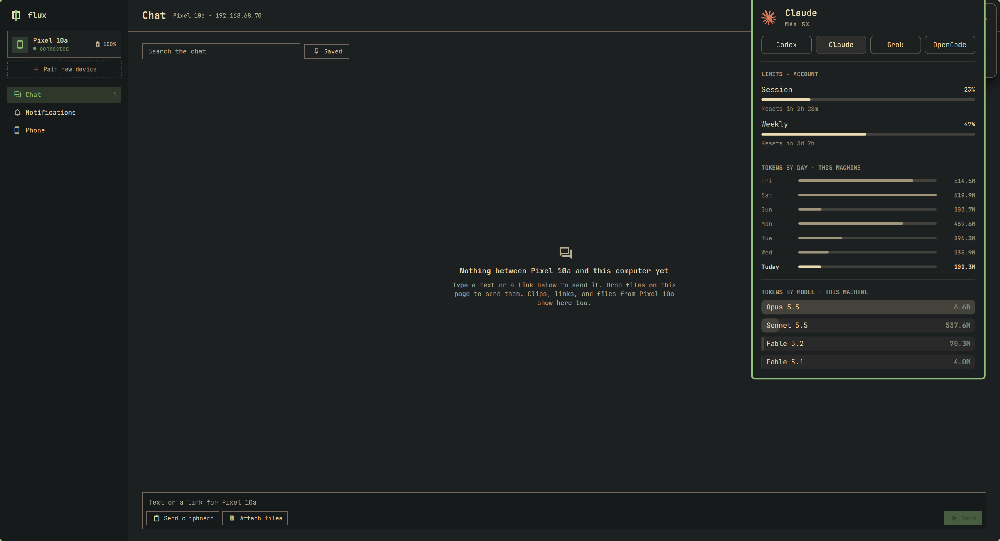
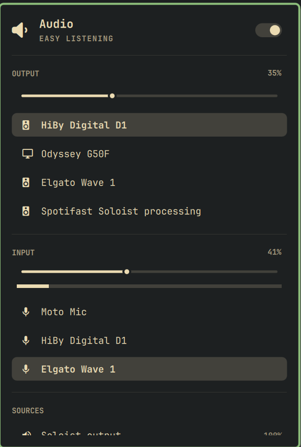

# widgets

<table>
  <tr>
    <td align="center"> calendar</td>
    <td align="center"> flux</td>
    <td align="center"> ethernet</td>
  </tr>
  <tr>
    <td align="center"> system monitor</td>
    <td align="center"> ai coding plans</td>
    <td align="center"> audio</td>
  </tr>
</table>

The panels on my bar: calendar, flux, ethernet, system monitor, ai coding plans and audio.
[quickshell](https://quickshell.org), driven by [omarchy](https://github.com/omacom/omarchy)

## pages

- [calendar](calendar/) · [flux](flux/) · [ethernet](ethernet/) · [system monitor](system-monitor/) · [ai coding plans](ai-coding-plans/) · [audio](audio/)
