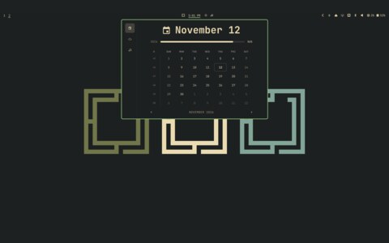
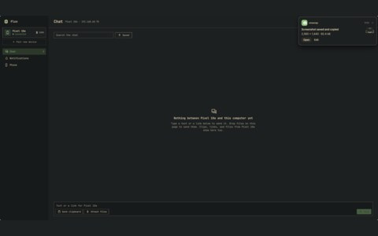
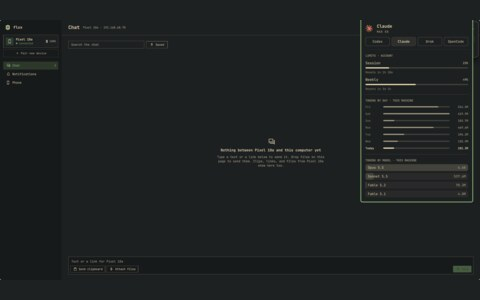

# widgets

## gallery

<table>
  <tr>
    <td align="center"> calendar</td>
    <td align="center"> flux</td>
    <td align="center"> ethernet</td>
  </tr>
  <tr>
    <td align="center"> system monitor</td>
    <td align="center"> ai coding plans</td>
  </tr>
</table>

## files

- no theme files of their own: the widgets read the colours omarchy generates from the theme

## project

- The panels on my bar, drawn with quickshell
- [omarchy](https://github.com/omacom/omarchy)
