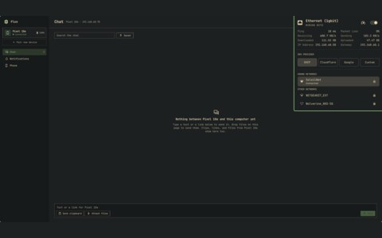
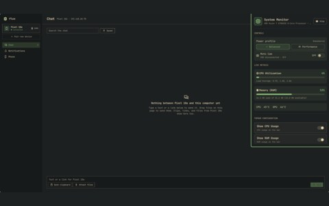

# widgets

<table>
  <tr>
    <td align="center"> calendar</td>
    <td align="center"> flux</td>
    <td align="center"> ethernet</td>
  </tr>
  <tr>
    <td align="center"> system monitor</td>
    <td align="center"> ai coding plans</td>
  </tr>
</table>

- The panels on my bar: calendar, flux, ethernet, system monitor and ai coding plans
- [quickshell](https://quickshell.org), driven by [omarchy](https://github.com/omacom/omarchy)
