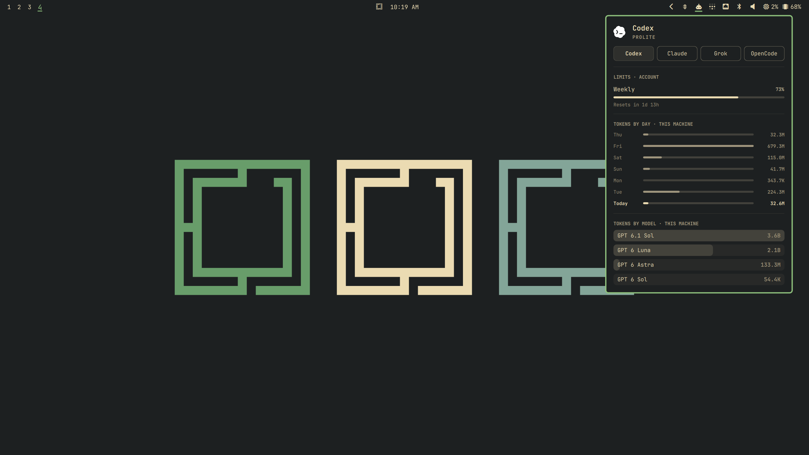
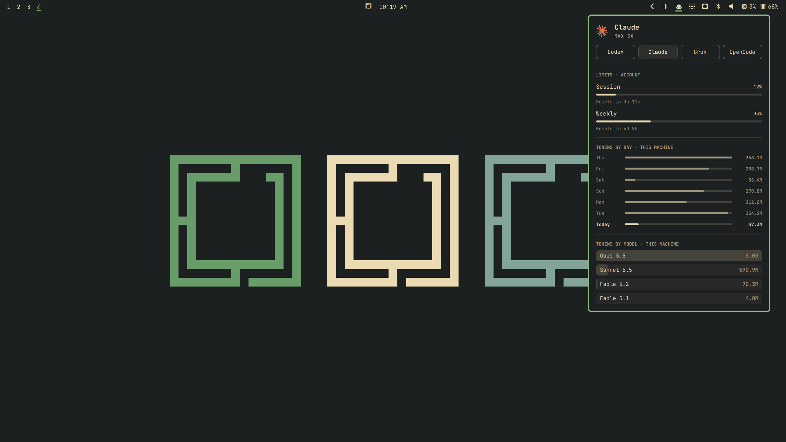
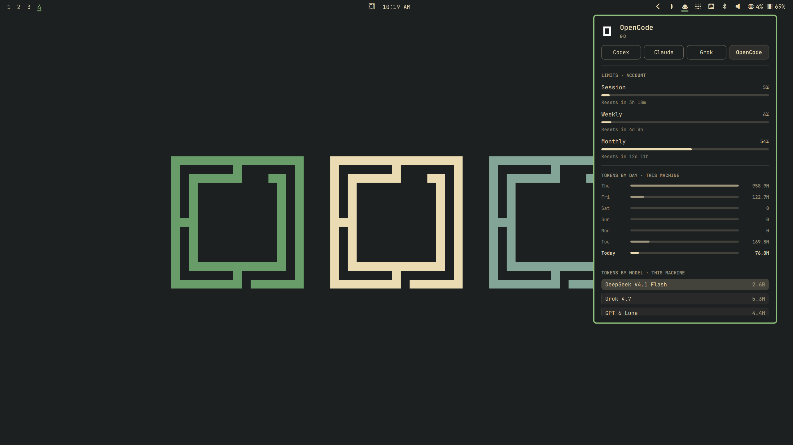

# verdigris for the ai coding plans widget

<table>
  <tr>
    <td align="center"> ai coding plans</td>
    <td align="center"> ai coding plans, second view</td>
    <td align="center"> ai coding plans, third view</td>
  </tr>
</table>

The ai coding plans panel on my bar. [omarchy widgets](..)

## files

- no separate file: the colors come from the [omarchy theme](../../)
