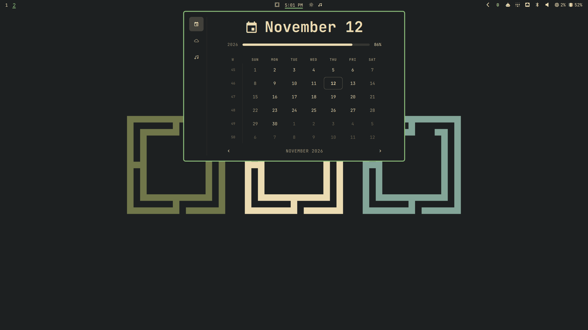
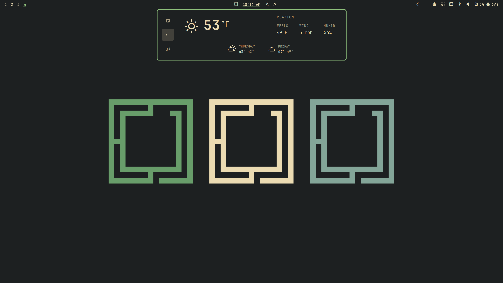
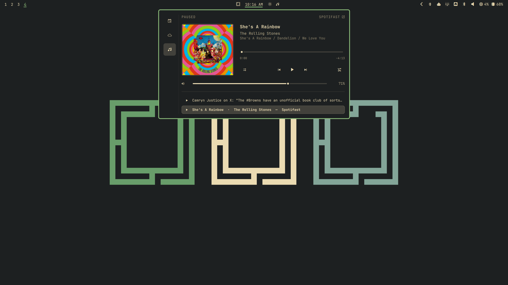

# verdigris for the calendar widget

<table>
  <tr>
    <td align="center"> calendar</td>
    <td align="center"> month view</td>
    <td align="center"> calendar, second view</td>
  </tr>
</table>

The calendar panel on my bar. [omarchy widgets](..)

## files

- no separate file: the colors come from the [omarchy theme](../../)
