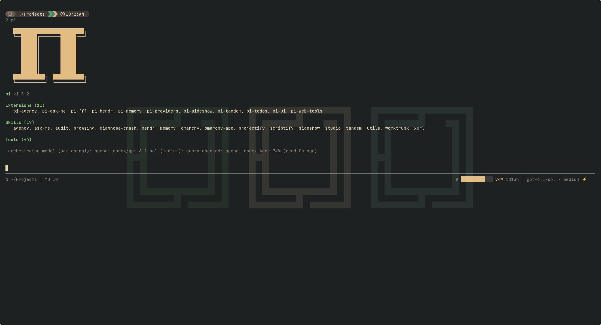

# verdigris for pi

<table>
  <tr>
    <td align="center"> pi</td>
  </tr>
</table>

Coding agent harness, with the theme loaded. [pi](https://github.com/earendil-works/pi)

## files

- `verdigris.json`
