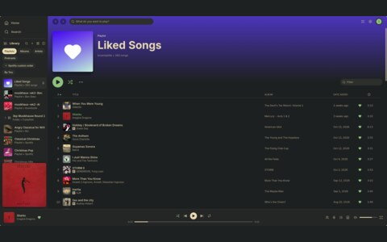

# spotifast

<table>
  <tr>
    <td align="center"> library</td>
    <td align="center"> album grid</td>
    <td align="center"> playing</td>
  </tr>
</table>

- Spotify client
- Follows the Omarchy system theme, so on an Omarchy desktop it needs no separate Verdigris theme file.
- Without Omarchy, copy [`verdigris.json`](verdigris.json) into `~/.config/spotifast/themes/` and pick `verdigris` under Appearance; it holds the exact colors Omarchy's Spotifast template renders from the palette.
