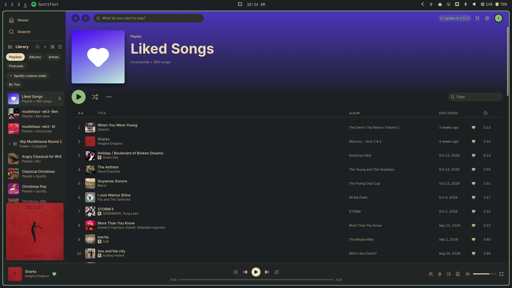

# verdigris for spotifast

<table>
  <tr>
    <td align="center"> spotifast</td>
  </tr>
</table>

Spotify client. Follows the Omarchy system theme, so on an Omarchy desktop it needs no separate Verdigris theme file.

## files

- [`verdigris.json`](verdigris.json)

## install

Without Omarchy, copy `verdigris.json` into `~/.config/spotifast/themes/` and pick `verdigris` under Appearance. It is kept by hand to match the colors Omarchy's own Spotifast template renders for Verdigris.
