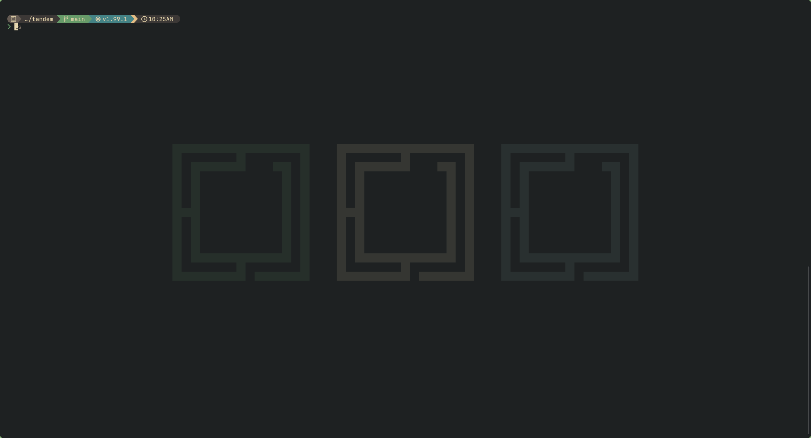
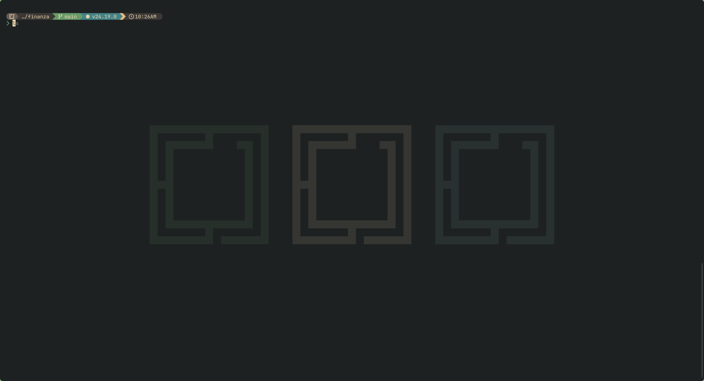
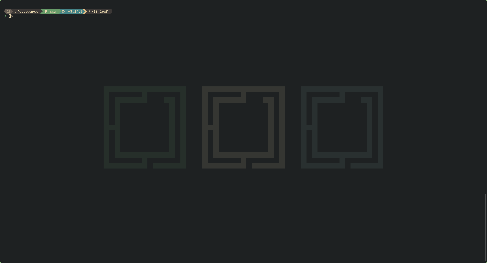

# verdigris for starship

<table>
  <tr>
    <td align="center"> the prompt, beside fastfetch</td>
    <td align="center"> prompt, second view</td>
    <td align="center"> prompt, third view</td>
  </tr>
</table>

Prompt. [starship](https://github.com/starship/starship)

## files

- `verdigris.toml`
