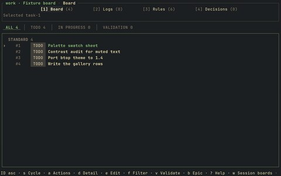
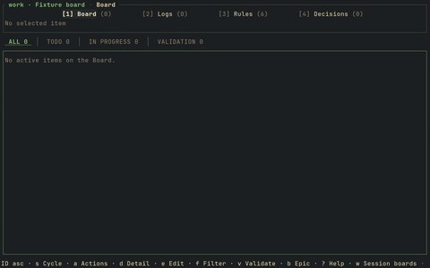

# tandem

<table>
  <tr>
    <td align="center"> board</td>
    <td align="center"> seeded board</td>
  </tr>
</table>

- Task board
- [tandem](https://github.com/Algorant/tandem)

## files

- `verdigris.toml`
