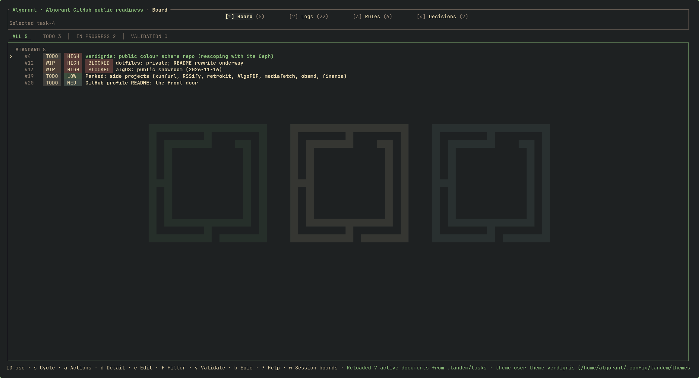
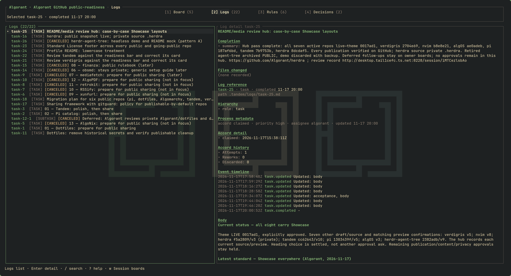
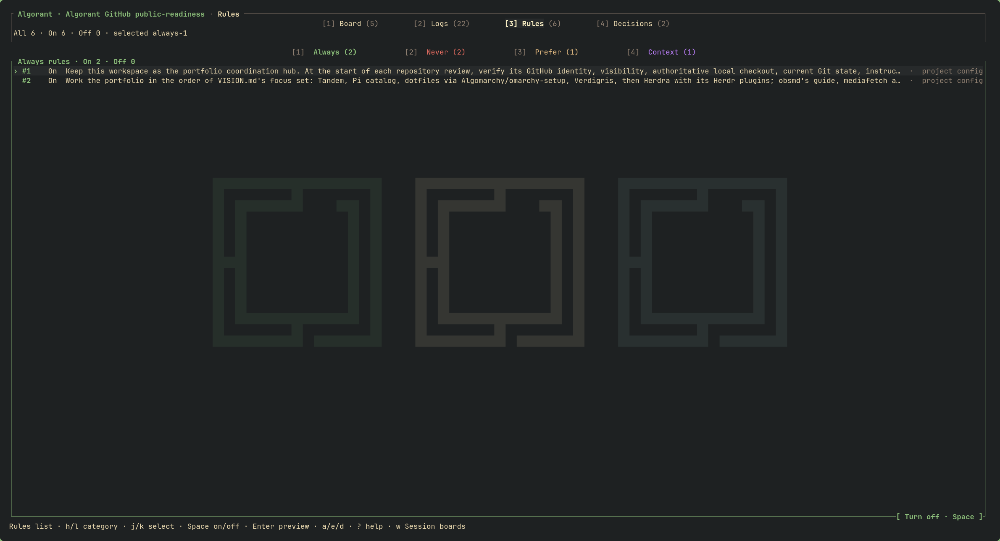
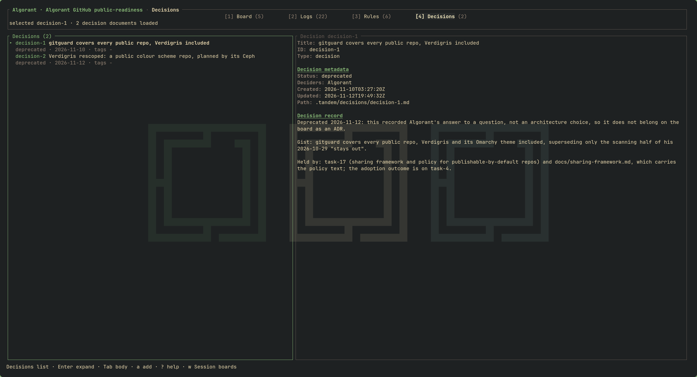

# verdigris for tandem

<table>
  <tr>
    <td align="center"> board</td>
    <td align="center"> board, second view</td>
  </tr>
  <tr>
    <td align="center"> board, third view</td>
    <td align="center"> board, fourth view</td>
  </tr>
</table>

Task board. [tandem](https://github.com/Algorant/tandem)

## files

- `verdigris.toml`
