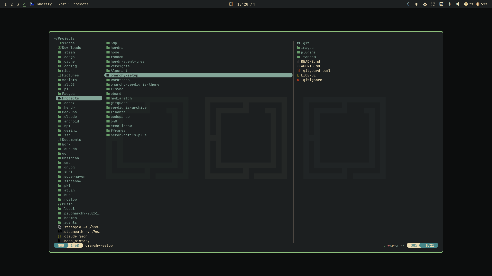
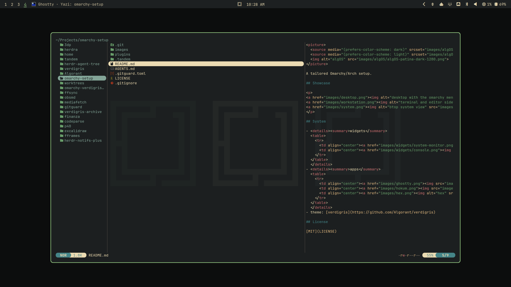
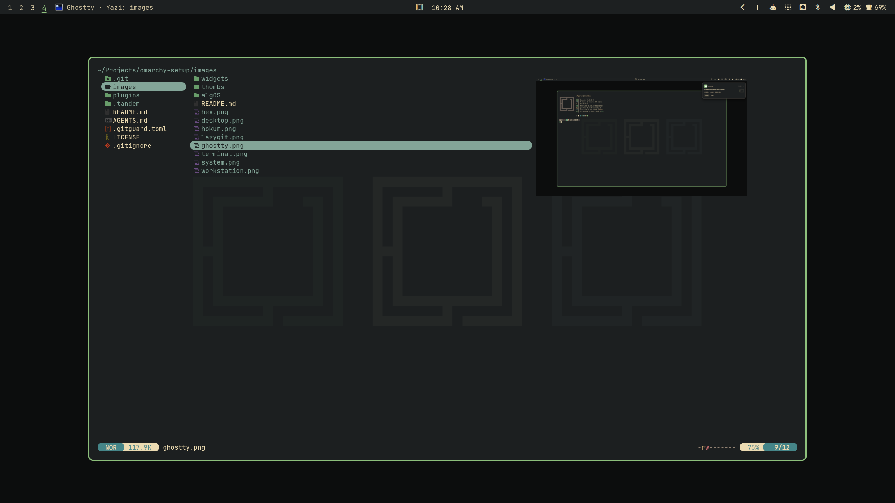

# verdigris for yazi

<table>
  <tr>
    <td align="center"> yazi</td>
    <td align="center"> yazi, second view</td>
    <td align="center"> yazi, third view</td>
  </tr>
</table>

File manager for the terminal. [yazi](https://github.com/sxyazi/yazi)

## files

- `verdigris.toml`
