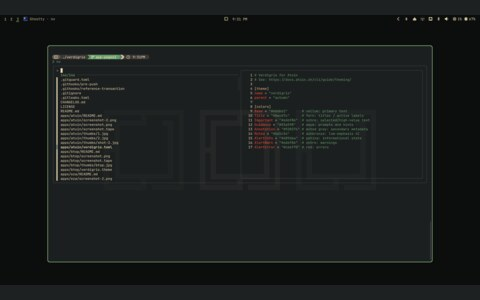

# zsh

<table>
  <tr>
    <td align="center"> a file preview from my nv alias</td>
  </tr>
</table>

- My shell, with [zsh-patina](patina) doing the highlighting
- [zsh](https://github.com/zsh-users/zsh)

## files

- [`patina/`](patina) — the syntax-highlighting theme
