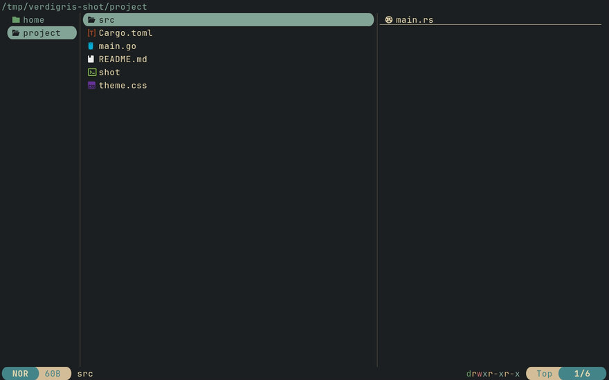
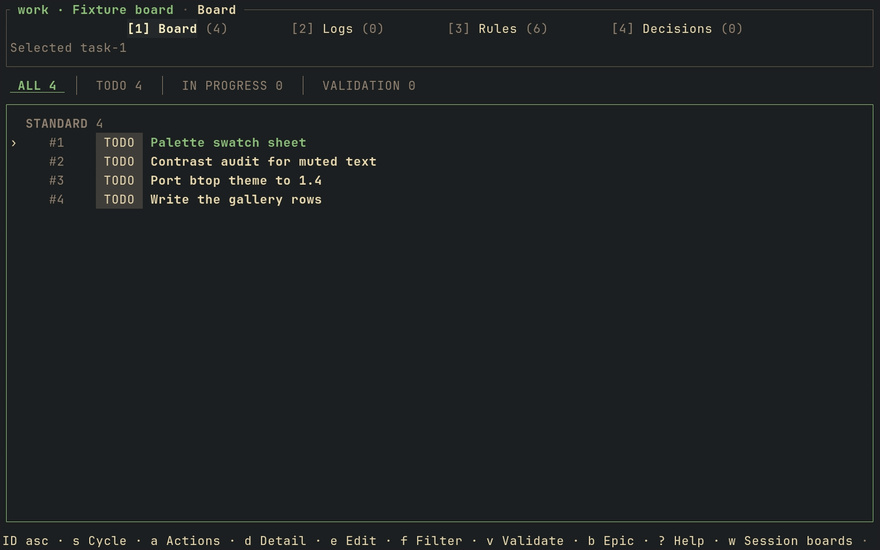
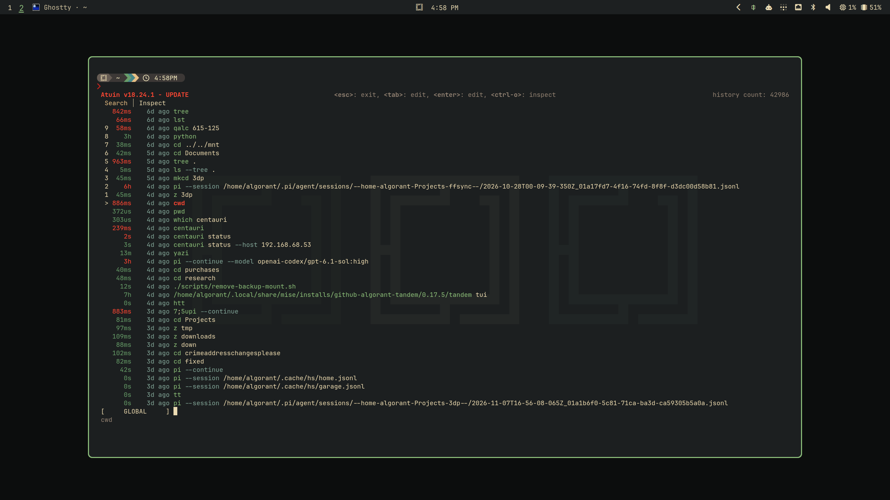

# Showcase quality comparison

The same four screenshots, in the same order, at the same 200 px cells the
README gallery uses, in three encodes: A the current gallery files, B a
higher-quality JPEG at identical dimensions, C the lossless originals. Compare
them inline at normal size, or use your browser's zoom for a closer look.
Clicking any image opens its full-resolution original — the same original in
every variant — so the links are for reading detail, not for comparing variants.

## A — current gallery files

880 × 550 JPEG, quality 85, 4:4:4 — 164,087 bytes for these four.

<table>
  <tr>
    <td align="center"> btop</td>
    <td align="center"> atuin</td>
    <td align="center"> yazi</td>
    <td align="center"> tandem</td>
  </tr>
</table>

## B — higher-quality JPEG, same dimensions

880 × 550 JPEG, quality 95, 4:4:4 — 243,097 bytes for these four (+48% on A).

<table>
  <tr>
    <td align="center"> btop</td>
    <td align="center"> atuin</td>
    <td align="center"> yazi</td>
    <td align="center"> tandem</td>
  </tr>
</table>

## C — the originals, lossless

1600 × 1000 PNG, the committed screenshots unchanged — 664,470 bytes for these four (4.1× A).

<table>
  <tr>
    <td align="center"> btop</td>
    <td align="center"> atuin</td>
    <td align="center"> yazi</td>
    <td align="center"> tandem</td>
  </tr>
</table>

## Why these four

- **btop** — dense colour meters and gradients with very thin labels.
- **atuin** — small monospace text in several colours (node state, durations, paths).
- **yazi** — file tree with icons and hairline pane borders.
- **tandem** — box-drawing borders and status colours in an application UI.

All four are natively 1600 × 1000, so they share one outer shape with the
gallery's 16:10 frame and C can be the untouched original: no resize, no
re-encode, no padding, identical composition to A and B.

## Sizes and encodings

| | A current | B JPEG q95 | C originals |
| --- | --- | --- | --- |
| dimensions | 880 × 550 | 880 × 550 | 1600 × 1000 |
| encoding | JPEG q85, 4:4:4 | JPEG q95, 4:4:4 | PNG, lossless |
| btop | 71,040 | 112,043 | 312,705 |
| atuin | 26,615 | 36,795 | 120,294 |
| yazi | 24,192 | 31,114 | 78,012 |
| tandem | 42,240 | 63,145 | 153,459 |
| **these four** | **164,087** | **243,097** | **664,470** |
| all fourteen gallery shots, measured | 519,775 | 796,950 | — |

Closeness to a lossless 880 × 550 render of the same frame, as measured file
figures: A averages 42.4 dB peak signal-to-noise, B 47.7 dB (btop 39.2 / 45.1,
atuin 43.5 / 48.7, yazi 45.1 / 49.8, tandem 41.8 / 47.2).

## The gallery, for context

The fourteen originals are eight at 2560 × 1440 (16:9), five at 1600 × 1000
(16:10) and one at 2530 × 1369 (1.848). This sample is four of the five 16:10
shots. The ten outside the sample are not all 16:9: eight are 16:9, one is the
remaining 16:10 shot (leaf) and one is the 1.848 widget shot (system monitor).
Because of that mix, C's byte figures above cover only these four; the other ten
would need padding or a different outer shape to be inlined as originals.

Pick one and the gallery moves to it; until then the README keeps A.

## Checks

- Every file identified: A and B are 880 × 550 JPEG (quality 85 and 95), C is
  the committed 1600 × 1000 PNG, byte-identical to `apps/`.
- Byte totals are the sizes of the exact files the tables reference; the
  fourteen-shot figures were measured by rebuilding every gallery thumbnail at
  each setting.
- The closeness figures compare each JPEG with a lossless render of the same
  frame; they are file measurements.
- No display measurement was possible in this session: the paired browser was
  offline, so there is no screenshot of this page and no computed column width.
