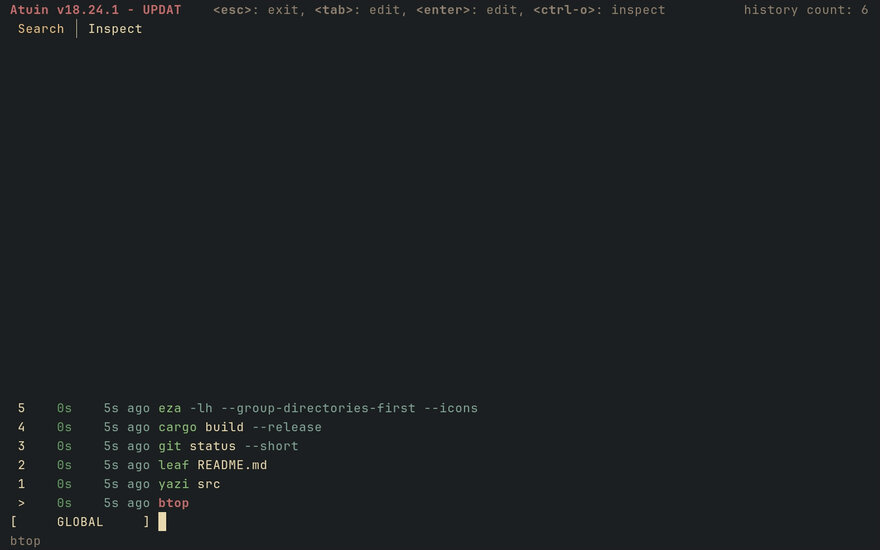
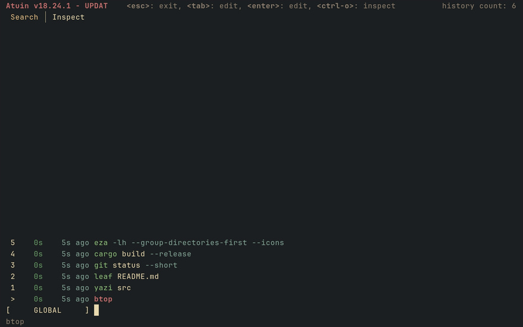
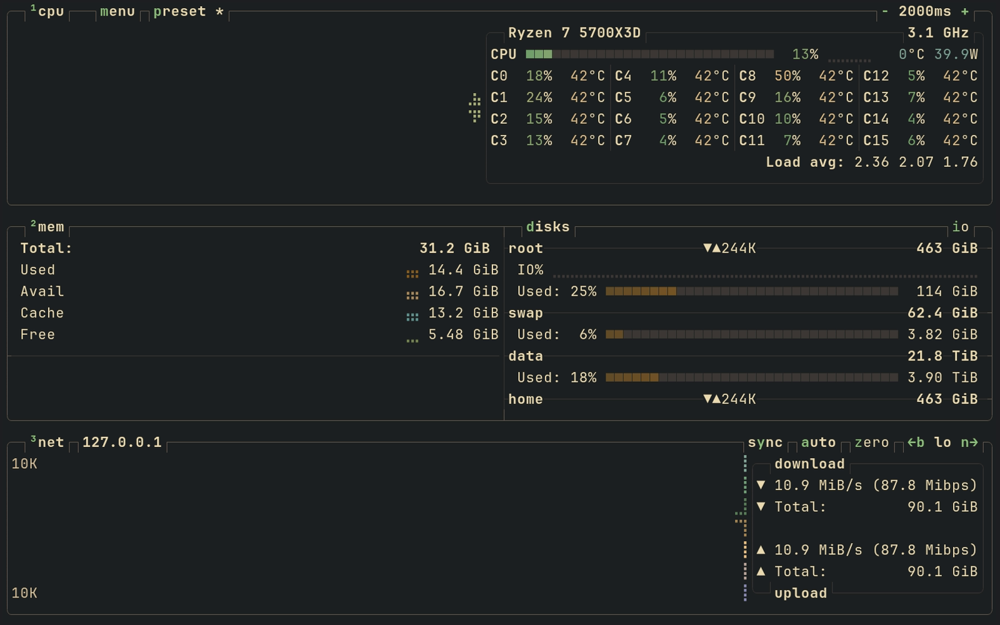

# Showcase quality comparison

Three versions of the same four Showcase screenshots, in the same order, at the
same 200 px cell width the README gallery uses. Nothing here changes the
gallery: the README still uses version A until you pick another.

Open the page on GitHub and click any image for the full-resolution original.
At cell size the three look nearly the same on purpose — judge them by zooming
in, or by opening the linked originals.

## The four shots, and why these

- **btop** — dense colour meters and gradients with very thin labels.
- **atuin** — small monospace text in several colours (node state, durations, paths).
- **yazi** — file tree with icons and hairline pane borders.
- **tandem** — box-drawing borders and status colours in an application UI.

All four are natively 1600 × 1000 (16:10), so every variant has the identical
outer shape and version C can be the untouched original.

## A — current gallery files

880 × 550, JPEG, quality 85, 4:4:4 chroma, fitted whole on `#1d2021`.
**164,087 bytes** for these four.

<table>
  <tr>
    <td align="center"> btop</td>
    <td align="center"> atuin</td>
    <td align="center"> yazi</td>
    <td align="center"> tandem</td>
  </tr>
</table>

## B — higher-quality JPEG, same dimensions

880 × 550, JPEG, quality 95, 4:4:4 chroma, same fit and background as A, so the
only difference is the encoder setting. **243,097 bytes** (+48% on A). Measured
closeness to a lossless copy of the same 880 × 550 frame: 47.7 dB peak
signal-to-noise against A's 42.4 dB.

<table>
  <tr>
    <td align="center"> btop</td>
    <td align="center"> atuin</td>
    <td align="center"> yazi</td>
    <td align="center"> tandem</td>
  </tr>
</table>

## C — the originals, inlined lossless

1600 × 1000 PNG, the original screenshots exactly as committed, no resize and
no re-encode. **664,470 bytes** (4.1× A). Only these four native 16:10 shots are
used, so the composition matches A and B exactly, with no padding.

<table>
  <tr>
    <td align="center"> btop</td>
    <td align="center"> atuin</td>
    <td align="center"> yazi</td>
    <td align="center"> tandem</td>
  </tr>
</table>

## The numbers together

| | A current | B JPEG q95 | C originals |
| --- | --- | --- | --- |
| dimensions | 880 × 550 | 880 × 550 | 1600 × 1000 |
| encoding | JPEG q85, 4:4:4 | JPEG q95, 4:4:4 | PNG, lossless |
| btop | 71,040 | 112,043 | 312,705 |
| atuin | 26,615 | 36,795 | 120,294 |
| yazi | 24,192 | 31,114 | 78,012 |
| tandem | 42,240 | 63,145 | 153,459 |
| **these four** | **164,087** | **243,097** | **664,470** |
| all fourteen, measured | 519,775 | 796,950 | n/a — 8 shots are 16:9 and would need padding |

## Pick one

**A** keeps the gallery as it is; **B** costs about 48% more bytes for a
measurably closer encode; **C** inlines full-resolution originals, which is
sharpest at any zoom and costs 4× the bytes. Reply with the letter.

Two things worth knowing before picking: at 200 px cells a 2x display uses 400
device pixels, so even A is 2.2× oversampled and B's advantage only appears when
someone zooms or uses a 3x screen; and C's byte cost above covers four 16:10
shots only — the other ten gallery shots are 16:9, so inlining originals there
would either change the outer shape or need padding.

## Checks

- Every file above identified: A and B are 880 × 550 JPEG (quality 85 and 95),
  C is the committed 1600 × 1000 PNG original, byte-identical to `apps/`.
- Byte totals are `stat` sizes of the exact files the tables reference.
- Closeness figures compare each JPEG with a lossless 880 × 550 render of the
  same frame; they are file measurements, not a display measurement.
- No display measurement was possible in this session: the paired browser was
  offline, so there is no screenshot of this page and no computed column width.
