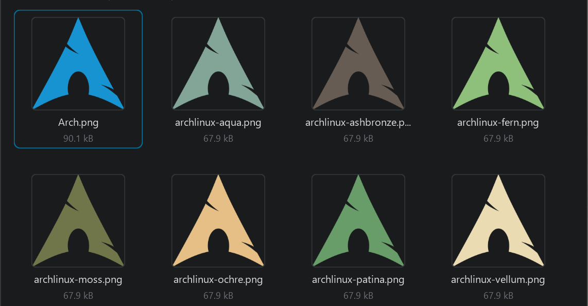

# Verdigris for Windows Terminal



Verdigris is available as a Windows Terminal color scheme named `Verdigris`.

Typical Windows Terminal settings location:

```text
%LOCALAPPDATA%\Packages\Microsoft.WindowsTerminal_8wekyb3d8bbwe\LocalState\settings.json
```

From WSL, translate your Windows settings path with `wslpath`.

## Scheme

Copy this object into the top-level `schemes` array in Windows Terminal `settings.json`:

```json
{
    "name": "Verdigris",
    "background": "#1B1B1B",
    "foreground": "#EBDBB2",
    "cursorColor": "#E6BF86",
    "selectionBackground": "#665C54",
    "black": "#1B1B1B",
    "red": "#CC241D",
    "green": "#689D6A",
    "yellow": "#D8A65C",
    "blue": "#458588",
    "purple": "#B16286",
    "cyan": "#83A598",
    "white": "#A89984",
    "brightBlack": "#928374",
    "brightRed": "#FB4934",
    "brightGreen": "#8EC07C",
    "brightYellow": "#E6BF86",
    "brightBlue": "#83A598",
    "brightPurple": "#D3869B",
    "brightCyan": "#8EC07C",
    "brightWhite": "#EBDBB2"
}
```

Then set a profile to use it:

```json
"colorScheme": "Verdigris"
```

## Arch profile icons

Verdigris Arch Linux PNG profile icons live in:

```text
windows-terminal/icons/archlinux-verdigris/
```

They were recreated from an Arch Linux source icon, for example:

```text
%USERPROFILE%\Pictures\WSL Icons\Arch.png
```

Available main palette variants:

- `archlinux-ashbronze.png` — `#665c54`
- `archlinux-vellum.png` — `#ebdbb2`
- `archlinux-fern.png` — `#8ec07c`
- `archlinux-patina.png` — `#689d6a`
- `archlinux-aqua.png` — `#83a598`
- `archlinux-ochre.png` — `#e6bf86`
- `archlinux-moss.png` — `#70764a`

Example Windows Terminal profile setting after copying/stowing the icon to a Windows-visible path:

```json
"icon": "%USERPROFILE%\\Pictures\\WSL Icons\\archlinux-patina.png"
```

## Notes

- `foreground`, `brightWhite`: Verdigris vellum `#ebdbb2`.
- `selectionBackground`: Verdigris ashbronze `#665c54`.
- `green` / `brightGreen`: Verdigris patina `#689d6a` and fern `#8ec07c`.
- `cyan` / `brightBlue`: Verdigris aqua `#83a598`.
- `brightYellow` / cursor: Verdigris ochre `#e6bf86`.
- Missing terminal ANSI roles retain nearest Gruvbox Dark colors for compatibility and familiar shell output semantics.
